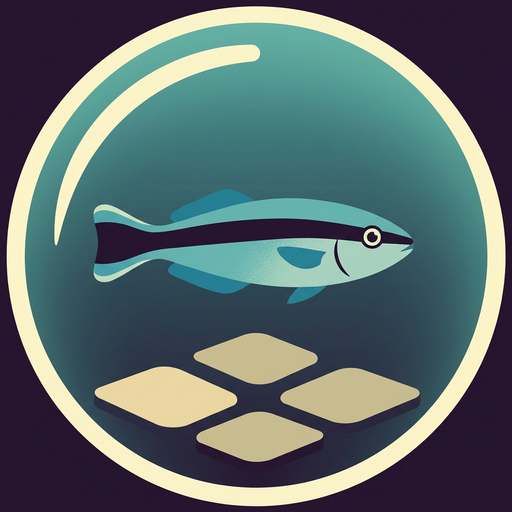

<p align="center">
  
</p>

<h1 align="center">Five Easy Pieces on Agentic AI</h1>

<p align="center"><em>AIMA's five agent types, from simple reflex to learning, run in Docker Sandboxes.</em></p>

<p align="center">
  <a href="https://codespaces.new/andreagalle/five-easy-pieces-agentic-ai?quickstart=1"></a>
</p>

<p align="center">
  <a href="https://github.com/andreagalle/five-easy-pieces-agentic-ai/actions/workflows/test.yml"></a>
  <a href="https://github.com/andreagalle/five-easy-pieces-agentic-ai/actions/workflows/sandbox.yml"></a>
  <a href="https://github.com/andreagalle/five-easy-pieces-agentic-ai/actions/workflows/pages.yml"></a>
  <a href="https://github.com/andreagalle/five-easy-pieces-agentic-ai/tags"></a>
  <a href="https://medium.com/docker-captains-wisdom/five-easy-pieces-on-agentic-ai-w-docker-sandboxes-53d5acb6e2e4"></a>
  <a href="references/sbx-notes.md"></a>
  <a href="examples/"></a>
  <a href="LICENSE"></a>
  <a href="LICENSE-text.md"></a>
  <a href="https://andreagalle.github.io/five-easy-pieces-agentic-ai/"></a>
</p>

A seven-part Medium series, the code behind it, and a public record of how it was made. Chapter 2 of Russell & Norvig's *Artificial Intelligence: A Modern Approach* already gave us the vocabulary for today's agentic AI. Docker Sandboxes give each agent *program* a disposable, reproducible *architecture* to run in, on a laptop or in the cloud, with the same commands.

**Status:** in progress. Examples 01 and 02 run in cloud sandboxes, with byte-identical output on the host and in the cloud. The overture and piece 01 are published on Medium, in Docker Captains Wisdom; piece 02 is a draft, and the other pieces follow weekly. Live status: [`site/_data/series.yml`](site/_data/series.yml) and the [making-of site](https://andreagalle.github.io/five-easy-pieces-agentic-ai/).

## The series

- **00** — [Five Easy Pieces on Agentic AI w/ Docker Sandboxes](https://medium.com/docker-captains-wisdom/five-easy-pieces-on-agentic-ai-w-docker-sandboxes-53d5acb6e2e4) (overture)
- **01** — [The simple reflex agent](https://medium.com/docker-captains-wisdom/piece-1-5-the-simple-reflex-agent-b34c17054a7b) → [`examples/01-simple-reflex/`](examples/01-simple-reflex/)
- **02** — The model-based reflex agent → [`examples/02-model-based/`](examples/02-model-based/)
- **03** — The goal-based agent → [`examples/03-goal-based/`](examples/03-goal-based/)
- **04** — The utility-based agent → [`examples/04-utility-based/`](examples/04-utility-based/)
- **05** — The learning agent → [`examples/05-learning/`](examples/05-learning/)
- **06** — The making of: Claude, Docker Sandboxes and a Codespace

Pieces 01 and 02 are deterministic programs that don't need a sandbox, and they run in one anyway, to learn the mechanics. Pieces 03 to 05 are LLM agents, and that's where the sandbox becomes necessary. The reasons are on [the five pieces](https://andreagalle.github.io/five-easy-pieces-agentic-ai/pieces/) page.

## Repository

- `examples/` — the agent programs, sharing one grid world (`examples/_shared/worlds/`)
- `articles/` — Medium drafts with their images and diagram sources
- `scripts/` — environment checks, the sandbox wrapper, the illustration generator
- `illustrations/` — the prompts behind every image, and what each one cost
- `references/` — bibliography, AIMA Chapter 2 concept map, `sbx` notes
- `site/` — the making-of: journal, decisions, workflow (GitHub Pages)

## Reproduce

Open the repository in a GitHub Codespace (or any Ubuntu 24.04 devcontainer), then:

```bash
make login       # sign sbx in to Docker (headless with the DOCKER_ID/DOCKER_PAT Codespaces secrets)
make check-env   # what this machine can run: cloud sandboxes, local sandboxes, neither
make test        # host-side unit tests
make run-01      # piece 01 in a cloud sandbox: tests, then the scenarios, then RUNINFO.json
make run-02      # piece 02: the same, with a stop and a restart in the middle
```

`make run-01` needs `sbx` signed in to Docker (`make login`), with cloud sandboxes enabled. In a Codespace created with the `DOCKER_ID` and `DOCKER_PAT` secrets, the setup script signs in on its own. Local sandboxes will be documented once they've been tested, which waits for the author to replace a laptop too old to run them ([ADR-0010](site/decisions/ADR-0010-cloud-only-until-local-is-tested.md)).

## Licence

- Code: MIT, see [`LICENSE`](LICENSE).
- Article text and site prose: CC BY 4.0, see [`LICENSE-text.md`](LICENSE-text.md). Quoted material from *AIMA* and other cited works is excluded and stays under its owners' copyright.
- Illustrations, including the icon above, are AI-generated (Google's Nano Banana 2, via OpenRouter), from the prompts in [`illustrations/`](illustrations/).

The articles will appear in the Medium publication [Docker Captains Wisdom](https://medium.com/docker-captains-wisdom), by andreagalle.
