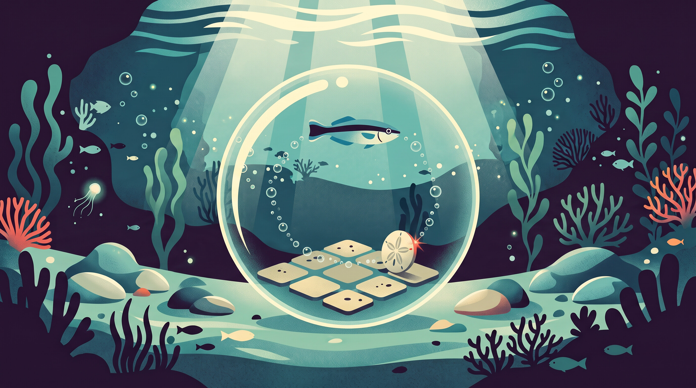

# Piece 1/5 — The simple reflex agent

*It has rules, no memory, and a wall it will push against forever.*



*AI-generated illustration.*

Every guardrail that blocks a tool call because it matches a pattern is a simple reflex agent. So is a thermostat, a spam rule, and the pre-commit hook that rejects your commit at six on a Friday evening. They look at what's in front of them, apply a rule, and act. They remember nothing, and most of the time that's exactly why they work.

## What AIMA says

The simplest agent in the book picks its action from the current percept alone, ignoring everything it perceived before (AIMA 4e, §2.4.2). Its program is a list of condition–action rules, such as *if the square is dirty, suck*. That's enough when the right action can be read off the present moment, which in the book's terms means the environment is fully observable.

Take away part of the view and things go wrong fast: a reflex agent that can't tell where it is can repeat the same useless action forever. The book's way out is to randomize, and it's candid that this is a patch. With a single agent in the world, a more sophisticated agent that doesn't gamble usually does better. That agent is piece 2.

## PEAS and environment

- **Performance measure:** one point for every clean square at every time step.
- **Environment:** two squares, the book's A and B, then a 4×4 grid. Dirt stays where it started.
- **Actuators:** Suck, Left, Right, Up, Down.
- **Sensors:** is this square dirty, did I just hit a wall, and (switchable) where am I.
- **Properties:** partially observable (badly so without the location sensor), single-agent, deterministic, sequential, static, discrete, known.

## The program

Three agents, a line or two apart ([full code](https://github.com/andreagalle/five-easy-pieces-agentic-ai/tree/piece-01-v1/examples/01-simple-reflex), docstrings trimmed):

```python
def reflex_vacuum_agent(percept: Percept) -> Action:
    """The two-square agent: suck if dirty, otherwise go to the other square."""
    if percept.dirty:
        return Action.SUCK
    if percept.location == (0, 0):
        return Action.RIGHT
    return Action.LEFT


def blind_reflex_agent(percept: Percept) -> Action:
    """The same rules without a location sensor."""
    if percept.dirty:
        return Action.SUCK
    return Action.RIGHT


class RandomizedReflexAgent:
    """Blind too, but flips a coin on clean squares."""

    def __init__(self, seed: int, moves: Sequence[Action] = (Action.LEFT, Action.RIGHT)):
        self.rng = random.Random(seed)
        self.moves = tuple(moves)

    def __call__(self, percept: Percept) -> Action:
        if percept.dirty:
            return Action.SUCK
        return pick(self.rng, self.moves)
```

The blind agent isn't stupid. It's the sighted agent's rules, minus the one fact they depended on.

## What happened

The book's own example is the smallest world it can draw: two squares, A and B, each clean or dirty (§2.1). The agent senses which square it's on and whether it's dirty, and the sighted agent's rules cover all four cases: suck if dirty, otherwise move to the other square. Starting on A with both dirty, it sucks, moves and sucks: all clean by step 3.

Over ten steps the best possible score is 20. The sighted agent gets 18, because B stayed dirty for two steps. Then it shuttles between clean squares for nothing, a waste the book itself points out, free only because the measure doesn't charge for moves.

Without the location sensor, the rule for a clean square has to pick one direction for good. Ours goes right. From B it sucks, hits the wall and keeps pushing, so A stays dirty forever and the score drops to 10. Going left would fail the same way from A. A coin flip breaks the tie: on average the agent finds the other square in two tries, and here it scores 18 again.


On a 4×4 grid the same rules get a bigger room to fail in. The blind agent cleans the top row (steps 1, 3, 5 and 7), reaches the right-hand wall and stays against it for the remaining 194 of its 200 steps. Twelve squares are never visited. The random agent picks one of four directions on each clean square. It does clean all 16, but a random walk keeps revisiting squares it has already cleaned, so the last corner falls only at step 82.


Each agent's score is the area under its line: 2666 for the wanderer, 788 for the one stuck at the wall, out of 3200.


## Run it in a sandbox

```bash
make run-01
```

That creates a cloud sandbox, copies the code in, runs the tests and then the scenarios, copies the results out with a `RUNINFO.json`, and deletes the sandbox. The line in `scripts/sbx-run.sh` that creates it denies all network by default:

```bash
sbx --cloud create --name "$name" --ttl "$ttl" --on-timeout delete \
  --cpus "$cpus" --memory "$memory" "${network_flags[@]}" --no-progress "$agent"
```

A locally tested version will follow once I've run it on a capable machine.

## What the sandbox adds: disposability

The sandbox lives about ten seconds, on the smallest size, with no network, and deletes itself if anything goes wrong first. What comes back is byte for byte the `results.json` produced on the host, though the sandbox runs Python 3.14 and the host 3.12. CI checks it again after every merge that touches the code.

Does this agent need a fence? No: it's forty lines of code I've read, with no network and no secrets. We fence it anyway, to learn the mechanics on a run where nothing can go wrong, and to show that changing the architecture doesn't change the program.

## Why it still matters

The sandbox's own network policy is a simple reflex agent: for each outbound request, if the host is on the list, allow it, otherwise deny it. It shares the reflex agent's blind spot, too. It judges each request alone, so it can't see what a hundred allowed requests add up to. Rules are fast and cheap. Memory is what piece 2 adds.

## Reproduce it

- **Code:** [`examples/01-simple-reflex`](https://github.com/andreagalle/five-easy-pieces-agentic-ai/tree/piece-01-v1/examples/01-simple-reflex) at tag `piece-01-v1`
- **Command:** `make run-01`
- **Sandbox:** cloud, `shell` template (`docker/sandbox-templates:shell-docker`), 1 vCPU / 2 GiB, no egress
- **Verified with:** `sbx` v0.50.0
- **Reference run:** 2026-10-27, commit `795ffb8`, `results.json` sha256 `efae1944…`

## The series

- Five Easy Pieces on Agentic AI w/ Docker Sandboxes (overture, link added at publication)
- **Piece 1/5 — The simple reflex agent** (you are here)
- Next: Piece 2/5 — The model-based reflex agent (coming soon)

*Disclosure: I'm a Docker Captain, and I'm enthusiastic about this technology. This article was written with the assistance of Claude (Anthropic), and the header image is AI-generated (Google's Nano Banana 2, via OpenRouter). The code and every run are reproducible from [five-easy-pieces-agentic-ai](https://github.com/andreagalle/five-easy-pieces-agentic-ai/tree/piece-01-v1) at tag `piece-01-v1`.*
