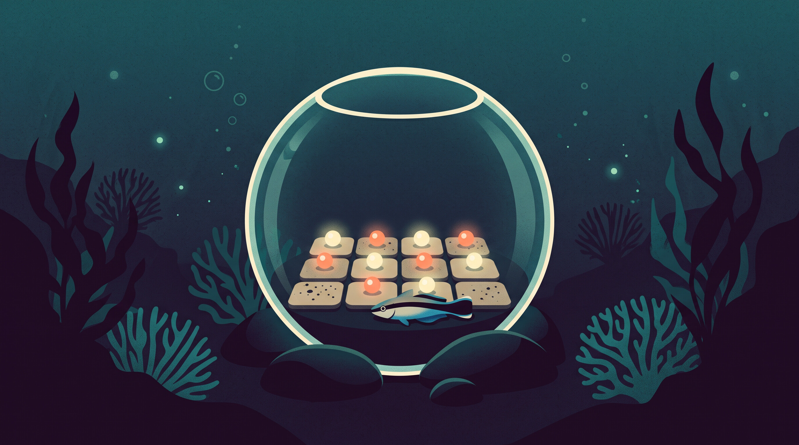

# Piece 2/5 — The model-based reflex agent

*Subtitle: to be written.*

*AI-generated illustration.*

<!-- Hook: a present-day agent that keeps a memory file, in 2-3 sentences. -->

## What AIMA says

<!-- §2.4.3: internal state, transition model, sensor model. Paraphrase only (ADR-0012). -->

## PEAS and environment

<!-- The same world as piece 1, same blind sensors. -->

## The program

<!-- At most 40 lines, with a link to the full code at the tag. -->

## What happened

<!-- The run's numbers, with the charts. -->

## Run it in a sandbox

<!-- Cloud commands, then one line on the local version (ADR-0010). -->

## What the sandbox adds, here: persistence

<!-- Stop and restart. Is the fence needed? Say why. -->

## Why it still matters

<!-- Today's twin: 2-3 sentences. -->

## Reproduce it

<!-- Tag, sbx version, template, the commands, the expected result. -->

## The series

- [Five Easy Pieces on Agentic AI w/ Docker Sandboxes](https://medium.com/docker-captains-wisdom/five-easy-pieces-on-agentic-ai-w-docker-sandboxes-53d5acb6e2e4) (overture)
- Previous: [Piece 1/5 — The simple reflex agent](https://medium.com/docker-captains-wisdom/piece-1-5-the-simple-reflex-agent-b34c17054a7b)
- **Piece 2/5 — The model-based reflex agent** (you are here)
- Next: Piece 3/5 — The goal-based agent (coming soon)

*Disclosure: I'm a Docker Captain, and I ❤️ this technology. This article was written with the assistance of Claude (Anthropic), and the header image is AI-generated (Google's Nano Banana 2, via OpenRouter). The code and every run are reproducible from [five-easy-pieces-agentic-ai](https://github.com/andreagalle/five-easy-pieces-agentic-ai/tree/piece-02-v1) at tag `piece-02-v1`.*
